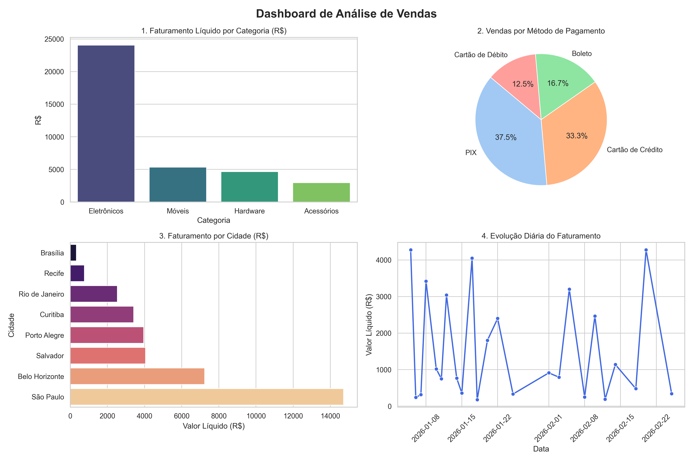

<h1 align="center">📊 Pandas Sales Analytics, RFM & ML Dashboard</h1>

<p align="center">
  
  
  
  
  
  
  
  
</p>

> Projeto completo de Análise de Dados e Data Science em Python utilizando **Pandas**, **NumPy**, **Scikit-Learn**, **Streamlit**, **Plotly**, **Seaborn** e **Matplotlib** para limpeza de dados, análise estatística, segmentação de clientes (RFM), regressão linear e visualização interativa em 2D e 3D.

---

##  Preview do Dashboard

<p align="center">
  
</p>

---

##  Funcionalidades

- ** Tratamento e Engenharia de Dados (`pandas_dashboard.py`)**:
  - Remoção de duplicatas e imputação de valores ausentes (`NaN`) pela mediana.
  - Criação de variáveis (`valor_bruto`, `valor_liquido`, `porte`, `mes`, `ano`).
- ** Segmentação RFM de Clientes**:
  - Cálculo de **R**ecência (dias desde a última compra), **F**requência (total de compras) e valor **M**onetário (total gasto).
  - Classificação automática em `Cliente VIP`, `Potencial Lealdade` e `Regular / Em Risco`.
- ** Machine Learning (`Scikit-Learn`)**:
  - Modelo de **Regressão Linear** para análise de tendência diária e previsão de faturamento futuro.
- ** Análise Estatística & Gráficos 2D/3D (`pandas_graficos.py` & `graficos_matplotlib.py`)**:
  - Mapa de Calor de Correlação (*Heatmap*) e análise de *Outliers* com *Boxplot*.
  - Visualização espacial em **3D** cruzando Quantidade, Preço Unitário e Avaliação.
- ** Web App Interativo (`app_streamlit.py`)**:
  - Aplicação web em **Streamlit** com filtros dinâmicos por cidade e categoria, KPIs em tempo real, cubo 3D interativo em **Plotly** e simulador de previsão de vendas.

---

## 📂 Estrutura do Projeto

```text
├── app_streamlit.py         # Dashboard Web Interativo (Streamlit + Plotly 3D)
├── pandas_dashboard.py      # Pipeline de dados, RFM e Regressão Linear (Scikit-Learn)
├── pandas_graficos.py       # Painel com 6 gráficos (Seaborn/Matplotlib)
├── graficos_matplotlib.py   # Gráfico de dispersão 3D interativo (Matplotlib)
├── vendas_loja.csv          # Base de dados bruta de vendas
├── dashboard_vendas.png     # Imagem gerada do painel analítico
└── requirements.txt         # Dependências do projeto
```

---

## 📦 Instalação

Clone o repositório e instale as dependências:

```sh
```sh
git clone git@github.com:03s9/training-pandas.git
cd training-pandas
pip install -r requirements.txt
```

---

## 💻 Como Executar

**1. Abrir o Dashboard Web Interativo no navegador (Streamlit):**
```sh
python3 -m streamlit run app_streamlit.py
```

**2. Gerar e abrir o painel com 6 gráficos estatísticos:**
```sh
python3 pandas_graficos.py
```

**3. Executar a análise RFM e previsão de Regressão Linear no terminal:**
```sh
python3 pandas_dashboard.py
```

**4. Abrir o gráfico 3D no Matplotlib:**
```sh
python3 graficos_matplotlib.py
```

---

## 👤 Autor

**Vitor Góngora**
* GitHub: [@03s9](https://github.com/03s9)
