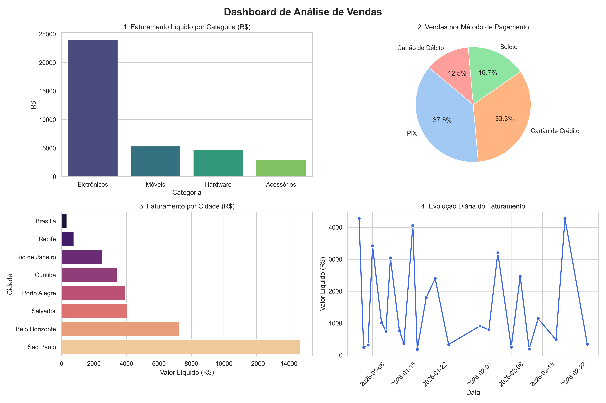

<h1 align="center">Training Pandas · Inteligência de Vendas</h1>

<p align="center">
  
  
  
  
  
  
  
  
  
  
</p>

> Análise de vendas com **Pandas**, **scikit-learn** e **FastAPI**; site em **React** com indicadores gerenciais, segmentação RFM, regressão e visualização 3D. O aplicativo Streamlit anterior continua disponível.

**Guias:** [instalação](docs/getting-started.md) · [CSV](docs/csv-schema.md) · [dashboard](docs/dashboard-guide.md) · [análises](docs/advanced-analysis.md) · [API](docs/api.md) · [arquitetura](docs/architecture.md) · [design](docs/design-system.md) · [testes](docs/testing.md) · [operação](docs/operations.md) · [problemas comuns](docs/troubleshooting.md).

---

##  Preview do aplicativo Streamlit anterior

<p align="center">
  
</p>

---

##  Funcionalidades

- ** Tratamento e Engenharia de Dados (`pandas_dashboard.py`)**:
  - Remoção de duplicatas e imputação de valores ausentes (`NaN`) pela mediana.
  - Criação de variáveis (`valor_bruto`, `valor_liquido`, `porte`, `mes`, `ano`).
- ** Segmentação RFM de Clientes**:
  - Cálculo de **R**ecência (dias desde a última compra), **F**requência (total de compras) e valor **M**onetário (total gasto).
  - Classificação automática em `Cliente VIP`, `Potencial Lealdade` e `Regular / Em Risco`.
- ** Machine Learning (`Scikit-Learn`)**:
  - Modelo de **Regressão Linear** para análise de tendência diária e previsão de faturamento futuro.
- ** Análise Estatística & Gráficos 2D/3D (`pandas_graficos.py` & `graficos_matplotlib.py`)**:
  - Mapa de Calor de Correlação (*Heatmap*) e análise de *Outliers* com *Boxplot*.
  - Visualização espacial em **3D** cruzando Quantidade, Preço Unitário e Avaliação.
- ** Web App Interativo (`app_streamlit.py`)**:
  - Visão gerencial com filtros por período, cidade e categoria, KPIs e gráficos interativos. RFM, regressão e 3D ficam em **Análises avançadas**.
  - Upload de CSV real na barra lateral. Sem upload, o app usa `vendas_loja.csv` como demonstração; o arquivo enviado não é gravado no repositório.

O CSV enviado deve conter as colunas `id_venda`, `data` (data reconhecida pelo pandas), `cliente`, `cidade`, `produto`, `categoria`, `quantidade`, `preco_unitario`, `desconto` (entre 0 e 1), `metodo_pagamento` e `avaliacao` (0 a 5). Use `vendas_loja.csv` como exemplo de formato.

---

## 📂 Estrutura do Projeto

```text
├── app_streamlit.py         # Dashboard Web Interativo (Streamlit + Plotly 3D)
├── api.py                   # API FastAPI do novo site
├── web/                     # Landing e dashboard React
├── pandas_dashboard.py      # Pipeline de dados, RFM e Regressão Linear (Scikit-Learn)
├── pandas_graficos.py       # Painel com 6 gráficos (Seaborn/Matplotlib)
├── graficos_matplotlib.py   # Gráfico de dispersão 3D interativo (Matplotlib)
├── vendas_loja.csv          # Base de dados bruta de vendas
├── dashboard_vendas.png     # Imagem gerada do painel analítico
└── requirements.txt         # Dependências do projeto
```

---

## 📦 Instalação

Novo site: Python 3.12, Node.js 20.19+ e npm. Em dois terminais:

```sh
python3.12 -m venv .venv
.venv/bin/python -m pip install -r requirements-api.txt
.venv/bin/python -m uvicorn api:app --reload
```

```sh
cd web
npm install
npm run dev
```

Abra `http://127.0.0.1:5173`. O site mostra a base de demonstração até você enviar um CSV real no dashboard. O upload fica em memória por uma hora; não é gravado no disco. O arquivo deve seguir as colunas descritas acima, com até 10 MB e 10 mil vendas.

Testes e build:

```sh
.venv/bin/python -m pytest -q
cd web && npm run build
```

---

## 💻 Como Executar

**Aplicativo Streamlit anterior (opcional):**
```sh
python3 -m streamlit run app_streamlit.py
```

**2. Gerar e abrir o painel com 6 gráficos estatísticos:**
```sh
python3 pandas_graficos.py
```

**3. Executar a análise RFM e previsão de Regressão Linear no terminal:**
```sh
python3 pandas_dashboard.py
```

**4. Abrir o gráfico 3D no Matplotlib:**
```sh
python3 graficos_matplotlib.py
```

---

## 👤 Autor

**Vitor Góngora**
* GitHub: [@03s9](https://github.com/03s9)
