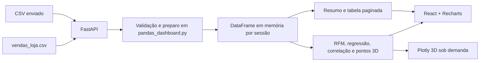

# Arquitetura

O frontend em `web/` é um app Vite com rotas `/`, `/dashboard` e `/analises`. Seu estado React guarda o identificador da base e os filtros enquanto a página permanece aberta. O proxy do Vite encaminha `/api` ao FastAPI. O backend reutiliza `carregar_dados`, `calcular_rfm` e `treinar_regressao_faturamento` do pipeline Python.

Uploads não são gravados no disco. Cada identificador aponta para um DataFrame e prazo de expiração; a próxima consulta remove sessões vencidas. A documentação de limites está em [operação](operations.md).
